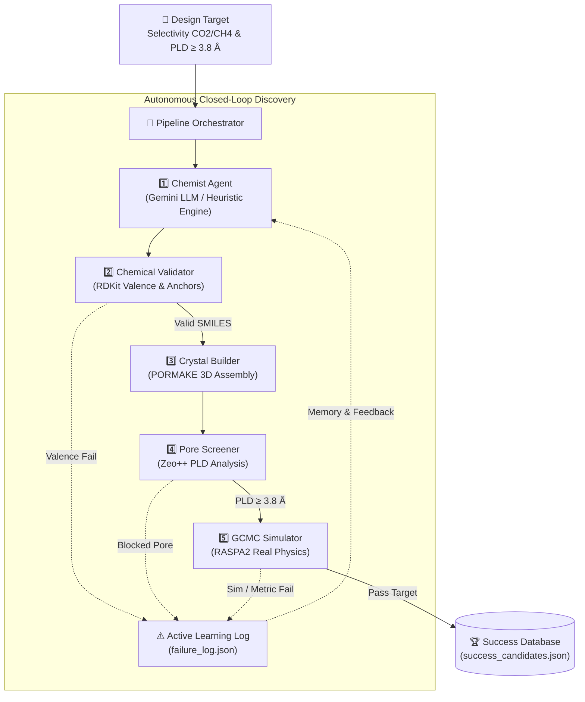

# Autonomous Closed-Loop Discovery Pipeline for MOF Adsorbents

[](#)
[](#)
[](#)
[](#)
[](#)

> 🎓 **Chemical Engineering Senior Project (Course 2105417) — Department of Chemical Engineering, Chulalongkorn University**  
> **Project Title:** Machine Learning-Driven System for the Design and Discovery of High-Performance Adsorbents in Greenhouse Gas Capture ($\text{CO}_2/\text{CH}_4$)  
> **Project Scope:** **Proof of Concept (PoC) / Academic Research Prototype**

---

## 📌 1. Overview & Proof of Concept Scope

This repository provides a **Proof of Concept (PoC)** autonomous closed-loop computational pipeline for the rational design, structural assembly, geometric screening, and molecular simulation of Metal-Organic Frameworks (MOFs) targeted at selective greenhouse gas capture ($\text{CO}_2/\text{CH}_4$).

### Core PoC Objectives
1. **Autonomous Closed-Loop Execution:** Validate an end-to-end multi-agent framework capable of reasoning over chemical functionalization, assembling 3D crystals, and running rigorous physical simulations without human-in-the-loop dependencies.
2. **Real Physical Simulations (100% Real Physics):** Full integration with classical simulation engines—**Zeo++** (Voronoi decomposition) and **RASPA2** (Grand Canonical Monte Carlo, GCMC)—eliminating any synthetic or mocked data.
3. **Active Learning Feedback Loop:** Capture failure mechanisms (e.g., valence invalidity, pore constriction, simulation errors) to autonomously refine the agent's chemical hypothesis pool in subsequent iterations.

---

## 🏗️ 2. System Architecture



### Pipeline Stages
| Stage | Module | Software / Tools | Core Responsibility |
| :---: | :--- | :--- | :--- |
| **1** | **Chemist Agent** | Google Gemini API / Expert Heuristic Pool | Proposes modified organic linkers (SMILES) and formulates chemical hypotheses (polarizability, dipole interactions). |
| **2** | **Chemical Validator** | [RDKit](src/chemistry/rdkit_validator.py) | Verifies valence compliance, aromatic integrity, and carboxylate anchoring groups ($\ge 2$ anchor points). |
| **3** | **Crystal Builder** | [PORMAKE](src/chemistry/pormake_builder.py) | Topologically assembles metal secondary building units ($\text{Zn}_4\text{O}$) and organic linkers into 3D periodic crystals (`.cif`). |
| **4** | **Pore Screener** | [Zeo++ (`network`)](src/screening/zeo_screener.py) | Computes Pore Limiting Diameter (PLD) via Voronoi cell decomposition (cutoff: $\text{PLD} \ge 3.8\text{ \AA}$). |
| **5** | **Adsorption Simulator** | [RASPA2 (`simulate`)](src/simulation/raspa_runner.py) | Conducts Grand Canonical Monte Carlo (GCMC) simulations for binary gas mixtures ($\text{CO}_2/\text{CH}_4 = 50:50$ at $298.15\text{ K}$, $1.0\text{ bar}$). |
| **Loop** | **Active Learning** | [Orchestrator](src/agents/orchestrator.py) | Aggregates operational logs, records failure modes, and feeds back insights to prevent cyclic mistakes. |

---

## 📂 3. Repository Structure

```text
senior_project_pipeline/
├── config/
│   ├── settings.yaml              # Pipeline configurations (T, P, gas composition, engine paths)
│   └── functional_groups.json     # Curated database of allowable functional groups (-NH2, -OH, -F, etc.)
├── data/
│   ├── building_blocks/           # Pre-configured secondary building units (Zn4O node, BDC linker .xyz)
│   ├── topologies/                # Crystal net definitions (pcu network)
│   ├── generated_cifs/            # Output folder for valid 3D periodic CIF structures (git-ignored)
│   └── database/                  # Storage for discovery records and failure logs (git-ignored)
├── src/
│   ├── agents/
│   │   ├── prompts.py             # Pydantic structured output schemas and system prompts
│   │   ├── chemist_agents.py      # LLM Agent (Gemini) with autonomous Heuristic Fallback
│   │   └── orchestrator.py        # Central closed-loop execution and active learning logic
│   ├── chemistry/
│   │   ├── rdkit_validator.py     # Chemical sanity & valence validation with RDKit
│   │   └── pormake_builder.py     # Automated MOF builder wrapper using PORMAKE
│   ├── screening/
│   │   └── zeo_screener.py        # Geometric pore diameter screening via Zeo++
│   ├── simulation/
│   │   ├── raspa_generator.py     # Dynamic simulation.input configuration builder
│   │   ├── raspa_runner.py        # GCMC process execution and environment manager
│   │   └── raspa_parser.py        # Adsorption loading extractor and selectivity calculator
│   └── pipeline.py                # Command-line entry point
├── tests/
│   └── test_pipeline.py           # Automated smoke and integration test suite
├── .env.example                   # Environment variable template for LLM API keys
├── requirements.txt               # Python package dependencies
├── LICENSE                        # MIT Open Source License
└── PROGRESS.md                    # Engineering progress and technical changelog
```

---

## ⚙️ 4. Prerequisites & Installation

The pipeline is designed and verified on **Linux / WSL2 (Ubuntu 22.04 / 24.04 LTS)**:

### External Physics Engines
Ensure the following native computational binaries are compiled and accessible in your system `PATH`:

| Tool | Verification Command | Purpose |
| :--- | :--- | :--- |
| **Zeo++** | `network -ha -res` | Geometric analysis and Voronoi pore size screening |
| **RASPA2** | `simulate -h` | Classical Grand Canonical Monte Carlo (GCMC) adsorption simulation |

### Python Environment Setup
```bash
# 1. Clone the repository
git clone https://github.com/your-username/mof-discovery-pipeline-poc.git
cd mof-discovery-pipeline-poc

# 2. Create and activate a virtual environment
python3 -m venv venv
source venv/bin/activate

# 3. Install dependencies
pip install --upgrade pip
pip install -r requirements.txt
```

---

## 🚀 5. Usage & Execution

### 5.1 Run an Autonomous Discovery Campaign
Initiate the pipeline to iteratively search for candidates until a specified number of successful designs are confirmed:

```bash
python src/pipeline.py --target 3 --max-trials 10
```

### 5.2 Chemist Agent Operation Modes
The pipeline supports two operational modes:

* **Online LLM Mode (Recommended for novel exploratory chemistry):**  
  Provide your Google Gemini API key by copying the template:
  ```bash
  cp .env.example .env
  # Set GEMINI_API_KEY="your_api_key_here" in .env
  ```
* **Offline Heuristic Mode (100% reproducible without internet):**  
  When no API key is set, the pipeline automatically falls back to an **Autonomous Chemical Heuristic Engine** that iteratively tests functionalizations based on chemical principles.

### 5.3 Automated Smoke Tests
Validate that all modules (RDKit, PORMAKE, Zeo++, RASPA2, and Orchestrator) function harmoniously:

```bash
pytest tests/
```

---

## 📊 6. Sample Proof of Concept Results

A benchmark candidate discovered during validation (recorded in `data/database/success_candidates.json`):

* **Scaffold:** $\text{MOF-5-NH}_2$ ($\text{Zn}_4\text{O}$ node + Amino-BDC linker, `pcu` topology)
* **Pore Limiting Diameter (Zeo++):** $8.286\text{ \AA}$ (exceeds kinetic cutoff of $3.8\text{ \AA}$)
* **$\text{CO}_2$ Loading (298.15 K, 1 bar):** $6.3809\text{ mol/kg}$
* **$\text{CH}_4$ Loading (298.15 K, 1 bar):** $0.0440\text{ mol/kg}$
* **$\text{CO}_2/\text{CH}_4$ Adsorption Selectivity:** **$144.94$**
* **Verification Status:** `is_mock: false` (Calculated with native RASPA2 GCMC)

---

## 🔮 7. Limitations & Future Directions

As a **Proof of Concept (PoC)**, current scope boundaries include:
1. **Target Topology:** Currently centered on the archetypal `pcu` net ($\text{Zn}_4\text{O}$ nodes, MOF-5 family) to demonstrate full closed-loop convergence.  
   *Future Scope:* Generalization to high-surface-area topologies (`fau`, `tbo`, `dia`, etc.).
2. **Gas Mixtures:** Focused on binary $\text{CO}_2/\text{CH}_4$ separation.  
   *Future Scope:* Flue gas mixtures ($\text{CO}_2/\text{N}_2$) and toxic gas capture ($\text{H}_2\text{S}$, $\text{SO}_2$).
3. **Surrogate ML Acceleration:** Integrating pre-screening GNN or surrogate regressors before running full GCMC trajectories for accelerated high-throughput screening.

---

## 📄 8. License & Attribution

* **License:** [MIT License](LICENSE)
* **Authors:** Senior Project Team, Department of Chemical Engineering, Faculty of Engineering, Chulalongkorn University
# Autonomous-Closed-Loop-Discovery-Pipeline-for-MOF-Adsorbents
